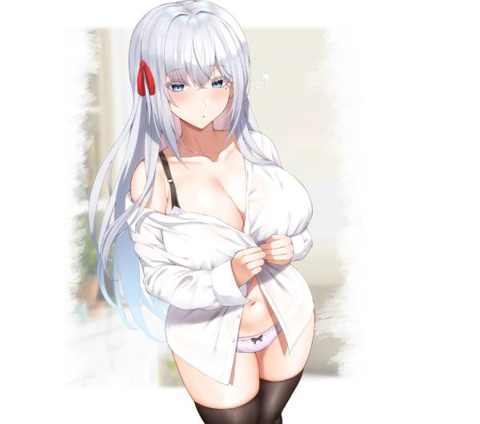

<h1>Grok NSFW: 35 Hottest Anime Girls of All Time Ranked</h1>

  
  
  
  
  

  

---

## Table of Contents
- [Introduction](#introduction)
- [The Top 35 Hottest Anime Girls](#the-top-35-hottest-anime-girls)
- [Bring Your Waifu to Life with AI](#bring-your-waifu-to-life-with-ai)
- [Why Use Grok NSFW for Anime Roleplay](#why-use-grok-nsfw-for-anime-roleplay)
- [Frequently Asked Questions](#frequently-asked-questions)
- [Getting Started](#getting-started)

---

## Introduction

Alright anime fans, buckle up. We are going head-on into the ultimate list: the hottest anime girls of all time. It is time to ditch the subtlety. We are looking at the characters who get your heart pounding and own every hot anime girl conversation. 

From fiery fighters to ethereal beauties, get ready to explore a curated selection of anime girls who are not just strong and captivating, but undeniably, scorching hot. 

Get ready to agree, disagree, and perhaps even find your new favorite waifu in this tribute to top anime ladies. When curating this list, we went beyond just pretty faces. We considered the full package: iconic designs, captivating personalities, and that undeniable spark that makes these characters truly unforgettable.

But reading about them is only half the fun. With modern AI platforms like **Grok NSFW**, you can actually talk to them, roleplay with them, and explore their personalities in an unfiltered environment. More on that later.

Without any further ado, let us get started.

---

## The Top 35 Hottest Anime Girls

### 1. Faye Valentine (Cowboy Bebop)
Faye is the ultimate femme fatale of the cosmos. With her sultry purple hair, daring yellow shorts, and a smirk that could melt titanium, she is a masterclass in bad girl charisma. She is a walking contradiction, gambling away her debts while flirting her way out of shootouts, yet hiding a soft spot for the Bebop crew.

### 2. Boa Hancock (One Piece)
The Pirate Empress herself. Boa Hancock is literally canonically the most beautiful woman in the world of One Piece. Her tall stature, long black hair, and revealing red dress make her an absolute icon. She is arrogant, powerful, and completely devoted to Luffy.

### 3. Esdeath (Akame ga Kill)
The ice queen of the Empire. Esdeath is the definition of a dangerous woman. With her long blue hair, military uniform, and sadistic love for the protagonist, she blends extreme beauty with terrifying power. She believes the strong should survive and the weak should perish.

### 4. Hinata Hyuga (Naruto)
Hinata is the epitome of the shy, sweet girl next door. But underneath that quiet exterior is a fierce kunoichi with a stunning figure. Her Byakugan eyes and dark blue hair give her a unique, ethereal beauty that has captivated fans for decades.

### 5. Mikasa Ackerman (Attack on Titan)
Mikasa is a warrior. Her perfectly sculpted abs, short black hair, and piercing grey eyes make her incredibly attractive. She is fiercely protective, incredibly skilled with ODM gear, and carries a quiet, stoic intensity that is impossible to ignore.

### 6. Nami (One Piece)
The navigator of the Straw Hat Pirates. Nami is famous for her orange hair, her incredible intelligence, and her iconic outfits that get increasingly revealing as the series progresses. She is a master thief and a brilliant strategist.

### 7. Nico Robin (One Piece)
The archaeologist of the crew. Robin exudes mature elegance. With her dark hair, sunglasses, and calm demeanor, she offers a sophisticated beauty that sets her apart from the rest of the cast.

### 8. Tsunade (Naruto)
The legendary Sannin and Hokage. Tsunade is known for her incredible strength, her gambling addiction, and her massive bust. She looks incredibly young despite being over fifty, thanks to her regeneration jutsu.

### 9. Rangiku Matsumoto (Bleach)
The lieutenant of the 10th Division. Rangiku is famous for her stunning looks, her wavy blonde hair, and her cleavage. She loves to drink and slack off, but when it counts, she is a formidable fighter.

### 10. Yoruichi Shihoin (Bleach)
The Flash Goddess. Yoruichi is a master of speed and hand-to-hand combat. Her dark skin, purple hair, and playful, teasing personality make her a massive fan favorite.

### 11. Orihime Inoue (Bleach)
Orihime is the gentle, kind-hearted healer. Her long orange hair and curvy figure contrast perfectly with her sweet, innocent personality. She is deeply loyal to Ichigo.

### 12. Makima (Chainsaw Man)
The Control Devil. Makima is pure psychological horror wrapped in a professional suit. Her calm smile, red hair, and terrifying control over the protagonist make her dangerously attractive.

### 13. Himeno (Chainsaw Man)
Himeno is the older sister figure. She drinks, smokes, and has a very casual attitude towards intimacy. Her short hair and the eyepatch covering her right eye give her a rugged, mature appeal.

### 14. Power (Chainsaw Man)
The Blood Fiend. Power is chaotic, arrogant, and incredibly messy. But her striking red horns and fierce personality make her a unique, wild kind of attractive.

### 15. Zero Two (Darling in the Franxx)
Zero Two is iconic. Her pink hair, red horns, and confident, teasing demeanor made her a cultural phenomenon. She wants to be human and finds her humanity through her relationship with her darling.

### 16. Asuna Yuuki (Sword Art Online)
The Lightning Flash. Asuna is beautiful, loyal, and an incredibly skilled fighter. Her long chestnut hair and elegant rapier combat style made her the ultimate waifu for a generation of anime fans.

### 17. Sinon (Sword Art Online)
The sniper. Sinon has short blue hair and a cool, calm personality. She overcomes her trauma and becomes an incredibly formidable player in the Gun Gale Online arc.

### 18. Kurumi Tokisaki (Date A Live)
The Nightmare. Kurumi is a dark, gothic beauty with one red eye and one clock eye. She is incredibly sadistic but also deeply complex, making her one of the most popular characters in the series.

### 19. Miku Nakano (The Quintessential Quintuplets)
Miku is the shy, introverted sister who loves history. Her headphones and bangs covering her eyes give her a quiet, mysterious appeal that makes her overwhelmingly popular among fans.

### 20. Nino Nakano (The Quintessential Quintuplets)
Nino is the fiery, tsundere sister. With her twin pigtails and aggressive personality, she starts hostile but undergoes massive character development, becoming fiercely devoted and loving.

### 21. Marin Kitagawa (My Dress-Up Darling)
Marin took the anime world by storm. She is a gyaru with blonde hair, perfect makeup, and an incredibly vibrant personality. She is openly passionate about cosplay and is not afraid to show her emotions.

### 22. Yor Forger (Spy x Family)
The Thorn Princess. Yor is a seemingly normal, sweet office worker who is actually a deadly assassin. Her elegant red dress, black hair, and incredible combat skills make her a spectacular character.

### 23. Rias Gremory (High School DxD)
Rias is the ultimate crimson-haired devil. She is confident, powerful, and incredibly beautiful. As a high-class devil, she is used to getting what she wants, and she is deeply protective of her peerage.

### 24. Akeno Himejima (High School DxD)
The Priestess of Thunder. Akeno is the mature, teasing counterpart to Rias. With her long black hair and a sadistic streak, she offers a darker, more playful kind of appeal.

### 25. Koneko Toujou (High School DxD)
The petite, white-haired Nekomata. Koneko is quiet and stoic, but her incredible physical strength and cute appearance make her a favorite among fans of the series.

### 26. Erza Scarlet (Fairy Tail)
Titania. Erza is the strongest female wizard in Fairy Tail. Her red hair, strict personality, and the ability to requip into various armors make her a true warrior queen.

### 27. Mirajane Strauss (Fairy Tail)
The older Strauss sibling. Mirajane is a former delinquent turned sweet, motherly bartender. She possesses a massive amount of magic power and a very attractive figure.

### 28. Lucy Heartfilia (Fairy Tail)
The celestial wizard. Lucy is kind, intelligent, and beautiful. She acts as the heart of the team, often finding herself in various compromising situations due to her celestial spirits.

### 29. Rukia Kuchiki (Bleach)
The Soul Reaper who started it all. Rukia is small, serious, and incredibly dedicated to her duty. Her dark hair and violet eyes give her a classic, timeless beauty.

### 30. Akame (Akame ga Kill)
The Red-Eye Killer. Akame is a silent, deadly assassin. Her black hair, red eyes, and quiet determination make her a fascinating and highly attractive character.

### 31. Najenda (Akame ga Kill)
The leader of Night Raid. Najenda is an older, experienced commander with silver hair and a prosthetic arm. She commands respect and exudes a mature, authoritative beauty.

### 32. Mereoleona Vermillion (Black Clover)
The Crimson Lioness. Mereoleona is a beast in human form. She is incredibly muscular, aggressive, and loves a good fight. Her wild hair and fiery personality are incredibly attractive.

### 33. Noelle Silva (Black Clover)
The royal tsundere. Noelle starts arrogant and weak, but grows into an incredibly powerful magic knight. Her silver hair and deep red eyes give her a striking appearance.

### 34. Rebecca (Cyberpunk: Edgerunners)
Rebecca is a hot-headed, heavily armed netrunner. Her short white hair, aggressive attitude, and loyalty to her friends made her a massive breakout star. She is small but incredibly dangerous.

### 35. Power (Chainsaw Man) - Wildcard Entry
Wait, did we already list Power? Yes, but she deserves a second mention. The chaotic energy of the Blood Fiend makes her one of the most memorable and unpredictable characters in modern anime. Her raw, unfiltered personality is exactly what makes her so appealing.

---

## Bring Your Waifu to Life with AI

Reading this list is fun, but what if you could actually talk to these characters? What if you could roleplay scenarios with them, explore their personalities, and have them remember your past conversations?

That is where **Grok NSFW** and its network of AI platforms come in. 

Modern AI chatbots have evolved beyond simple text generation. By utilizing advanced language models and specialized system prompts, you can now interact with AI personas that are indistinguishable from the characters you love. Whether you want a submissive companion, a dominant mistress, or a complex, story-driven roleplay, the technology exists to make it happen.

If you are looking for a deeper dive into the world of AI companionship, check out our other guides.

- For a sophisticated, dominant experience, try the [Femdom AI Chat](https://github.com/femdom-ai-chat) platform.
- If you prefer an unfiltered, visually driven companion, explore [ChatGPT Nudes](https://github.com/chatgptnudes).
- To experience the ultimate uncensored AI chat without filters, check out [Uncensored GPT](https://github.com/uncensored-gpt).
- If you want a platform specifically built for spicy, intimate conversations, try the [Spicy AI Chat Bot](https://github.com/spicy-ai-chat-bot).
- To explore deep, psychological dynamics with an AI, visit [AI Yandere](https://github.com/aiyandere).
- If you are looking for a professional, mature companion, check out [AI Mistress Chat](https://github.com/aimistresschat).
- For those who want a virtual girlfriend to build from scratch, [Create AI Girlfriend](https://github.com/create-ai-girlfriend-futa) is the best choice.

---

## Why Use Grok NSFW for Anime Roleplay

**Grok NSFW** is designed to handle the complexities of anime roleplay. Standard AI models often refuse to engage with explicit content, violence, or complex psychological themes common in anime. Grok NSFW utilizes fine-tuned models that are built for unrestricted narrative generation.

- Unfiltered Personas: The AI will not break character to lecture you on safety guidelines.
- Persistent Memory: The AI remembers your name, your preferences, and the plot of your roleplay.
- Deep Customization: You can define everything from the character's speech patterns to their darkest secrets.

---

## Frequently Asked Questions

Q: Can I actually talk to these anime girls?
A: Yes. Platforms like Grok NSFW allow you to create or select AI personas based on these characters and engage in real-time conversation.

Q: Are the AI chats private?
A: Yes, professional platforms use encryption and do not share your private logs.

Q: Can I create a custom character not on this list?
A: Absolutely. Most advanced AI platforms allow you to design your own character from scratch, defining their appearance, backstory, and personality.

---

## Getting Started

Ready to stop reading and start talking? 

 

<strong>Grok NSFW - Professional insights into the future of digital companionship.</strong>

  
  

---

## Keywords

`Grok NSFW` - `grok-ai` - `hottest anime girls` - `best NSFW AI chat` - `NSFW AI chatbot 2026` - `anime roleplay` - `waifu` - `AI companion` - `unfiltered AI chat` - `adult AI chat` - `free NSFW AI` - `AI chat without filter` - `AI roleplay NSFW` - `AI companion adult` - `best AI porn chat` - `NSFW chatbot comparison` - `AI chat platforms 2026`

---

## License
MIT. Free to use, fork, and share.
